<!-- ═══════════════════════  TITLE SCREEN  ═══════════════════════ -->
<p align="center">
  <a href="https://wittawat-eight.vercel.app/">
    
  </a>
</p>

<p align="center">
  <a href="https://wittawat-eight.vercel.app/">
    
  </a>
</p>

<p align="center">
  <a href="https://wittawat-eight.vercel.app/"></a>
  <a href="mailto:Dnaigook@gmail.com"></a>
  <a href="https://github.com/Sungear01"></a>
  
</p>

<br />

<!-- ═══════════════════════  PLAYER 1  ═══════════════════════ -->
##  Player 1

<p align="center">
  
</p>

<p align="center">
  
</p>

<details>
<summary><b> Character sheet (text version)</b></summary>
<br />

```js
const player1 = {
  name:     "Wittawat",
  class:    "Web developer & UI/UX designer",
  home:     "Bangkok, Thailand 🇹🇭",
  mainQuest:"My portfolio → wittawat-eight.vercel.app",
  weapons:  ["Laravel", "PHP", "React", "Node.js", "MySQL"],
  magic:    ["Figma", "Photoshop"],
  passive:  "Design first, then code — so the details stay sharp",
  contact:  "Dnaigook@gmail.com",
};
```

</details>

<!-- ═══════════════════════  INVENTORY  ═══════════════════════ -->
##  Inventory

<p align="center">
  
</p>

<!-- ═══════════════════════  DESIGN QUEST  ═══════════════════════ -->
##  Design quest

<p align="center">
  
</p>

<!-- ═══════════════════════  SIDE QUESTS  ═══════════════════════ -->
##  Side quests

<p align="center">
  
</p>

<details>
<summary><b> Training grounds (resources)</b></summary>
<br />
<p align="center">
  <a href="https://grow.google/uxdesign/"></a>
  <a href="https://lawsofux.com/"></a>
  <a href="https://help.figma.com/hc/en-us/categories/360002051613"></a>
  <a href="https://webaim.org/"></a>
  <a href="https://www.refactoringui.com/"></a>
</p>
</details>

<!-- ═══════════════════════  QUEST LOG  ═══════════════════════ -->
##  Quest log

<p align="center">
  <a href="https://github.com/Sungear01/Tiktet-UXUI"></a>
  <a href="https://github.com/Sungear01/WILDTRAIL"></a>
  <a href="https://github.com/Sungear01/line_webapp"></a>
  <a href="https://github.com/Sungear01/-Status-working-Installation-Tracker"></a>
</p>

<!-- ═══════════════════════  SAVE DATA  ═══════════════════════ -->
##  Save data

<p align="center">
  
  
</p>

<p align="center">
  
</p>

<p align="center">
  
</p>

<!-- Appears after the "Generate contribution snake" workflow runs once (Actions tab → Run workflow) -->
<p align="center">
  <picture>
    <source media="(prefers-color-scheme: dark)" srcset="https://raw.githubusercontent.com/Sungear01/Sungear01/output/github-contribution-grid-snake-dark.svg" />
    <source media="(prefers-color-scheme: light)" srcset="https://raw.githubusercontent.com/Sungear01/Sungear01/output/github-contribution-grid-snake.svg" />
    
  </picture>
</p>

<!-- ═══════════════════════  CONTINUE?  ═══════════════════════ -->
<p align="center">
  <a href="https://wittawat-eight.vercel.app/"></a>
</p>

<p align="center">
  <a href="https://wittawat-eight.vercel.app/"></a>
  <a href="mailto:Dnaigook@gmail.com"></a>
  <a href="https://github.com/Sungear01"></a>
</p>

<p align="center">
  
  
  
</p>
